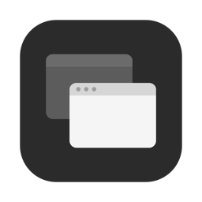
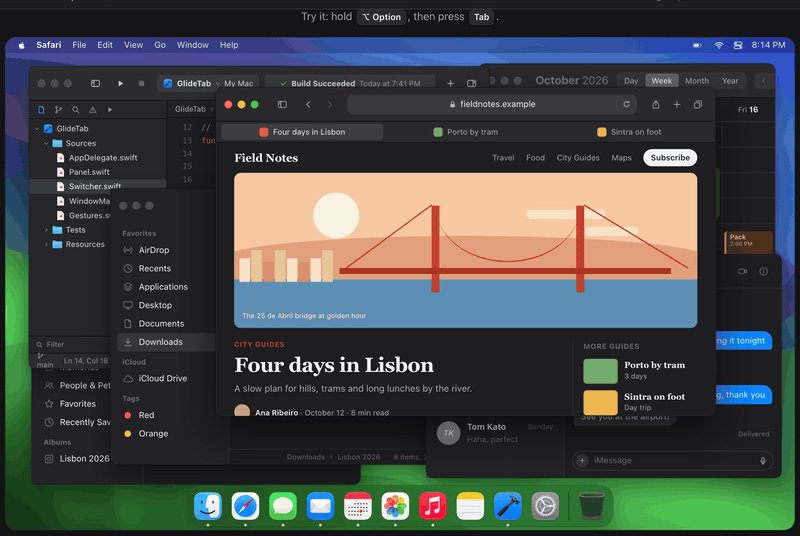
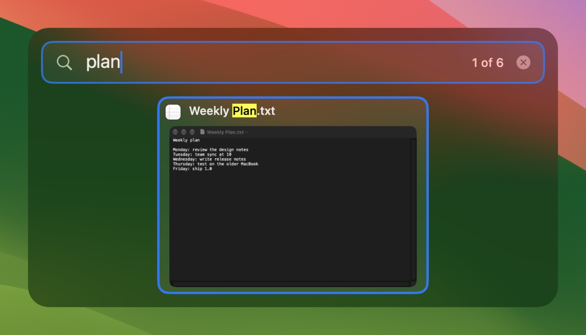
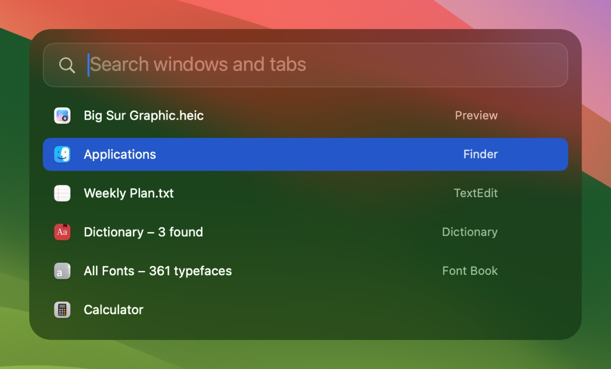
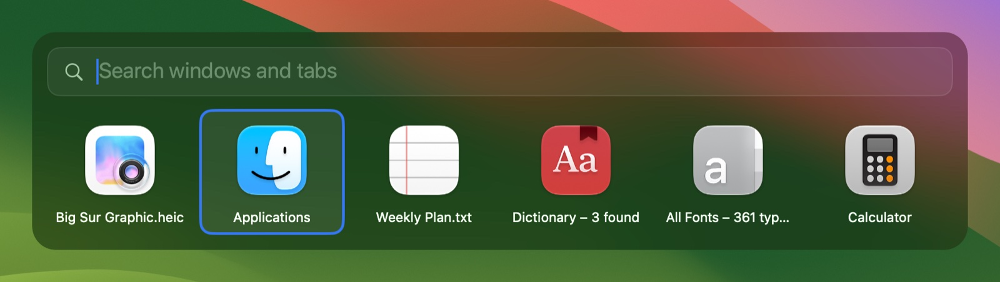
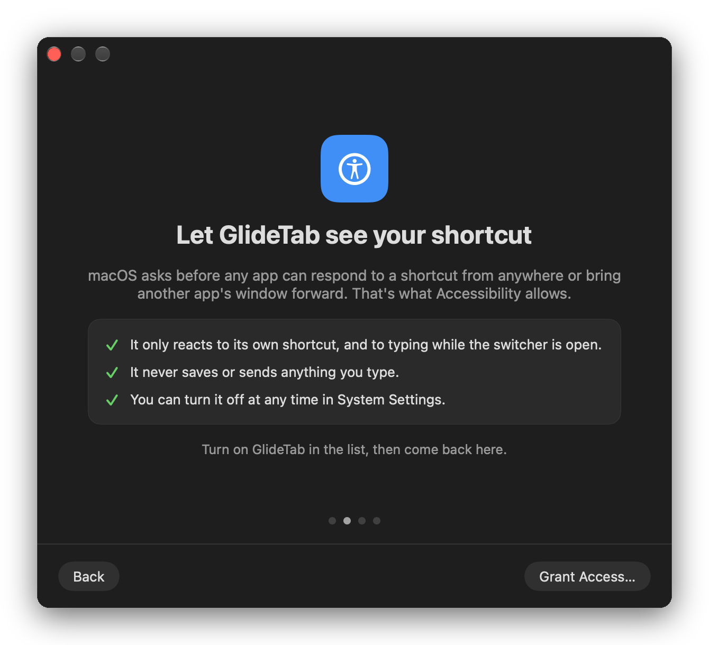

<div align="center">



# GlideTab

A fast, native window switcher for macOS.<br>
Hold <kbd>⌥ Option</kbd> and press <kbd>Tab</kbd> to see every open window, with a live preview.

<br>

<a href="https://github.com/mohdmahmodi/glidetab/releases/latest/download/GlideTab.zip"></a>

<sub>Free and open source · macOS 14 or later · Apple silicon and Intel</sub>

<br>

[](https://github.com/mohdmahmodi/glidetab/releases) [](https://github.com/mohdmahmodi/glidetab/actions) [](LICENSE)

[Website](https://glidetab.com) · [Features](https://glidetab.com/features) · [Compare](https://glidetab.com/compare) · [Release notes](https://github.com/mohdmahmodi/glidetab/releases)

<br>



</div>

<br>

## Features

### Every window, not just every app

The built-in ⌘Tab switches between apps. GlideTab shows each window on its own, including windows on other Spaces and displays, minimized windows and hidden apps. Small badges show where each one is.

### Type to find it

Start typing while the switcher is open to filter by window title or app name. Browser tabs show up too, from every window and every profile, so you can jump straight to a tab without hunting for its window.

<p align="center">
  
</p>

Works with Safari, Chrome, Brave, Edge, Vivaldi, Chromium, Firefox, LibreWolf and Zen.

### Pick a look

Thumbnails, app icons or a list, in four sizes, in light, dark or matching your system. App Icons and List don't need Screen Recording.

<p align="center">
  <br><br>
  
</p>

### Your shortcuts

Set up to nine shortcuts, each with its own keys and filter: all apps or just the active one, every Space or the current one, every display or the current one. You can also swipe with three or four fingers on the trackpad, or let GlideTab take over ⌘Tab.

### Act without switching

Hover over a window to close it, minimize it or make it full screen. Turn on the full-size preview to see the selected window in place before you switch.

### Also included

- Opens at login and lives in the menu bar
- Per-app rules: hide an app's windows, or let an app keep the shortcut for itself
- Recently used order, so a quick ⌥Tab takes you back to your last window
- VoiceOver support
- 21 languages
- Settings import and export
- Command-line tool
- Automatic updates, signed and notarized by Apple

## Install

1. [Download GlideTab.zip](https://github.com/mohdmahmodi/glidetab/releases/latest/download/GlideTab.zip) and unzip it.
2. Move **GlideTab** to your Applications folder and open it.
3. Follow the setup window. It explains each permission before macOS asks for it.

<p align="center">
<picture>
  <source media="(prefers-color-scheme: light)" srcset="docs/images/setup-light.png">
  
</picture>
</p>

GlideTab checks GitHub once a day and offers new versions as they come out. You can turn this off in Settings.

## Permissions

| Permission | What it's for | Needed |
| --- | --- | --- |
| Accessibility | Seeing the shortcut and bringing windows forward | Yes |
| Screen Recording | Thumbnails and the full-size preview, as still pictures only | Only for the Thumbnails style |
| Automation | Reading tabs, asked once per browser | Only for browser tabs |

GlideTab has no account, no analytics and no crash reporting. Window titles and pictures stay in memory and are never saved or sent anywhere. The only network request is the update check. Details are on the [privacy page](https://glidetab.com/privacy).

## Using GlideTab

| Press | To |
| --- | --- |
| <kbd>⌥</kbd> + <kbd>Tab</kbd> | Open the switcher, then move to the next window |
| <kbd>⇧</kbd> + <kbd>Tab</kbd> or arrow keys | Move back, or around the grid |
| Let go of <kbd>⌥</kbd> | Switch to the selected window |
| Type anything | Search windows and tabs |
| <kbd>Esc</kbd> | Clear the search, then close without switching |
| <kbd>Return</kbd> | Switch now |

Settings and Help are in the menu bar. If you hide the icon, open GlideTab again from Applications to get to Settings.

## Questions

<details>
<summary><b>Is it really free?</b></summary>
<br>

Yes. There's no paid version, no trial and no account. It's MIT licensed.

</details>

<details>
<summary><b>Can it replace ⌘Tab?</b></summary>
<br>

Yes. In Settings → Shortcuts, set a shortcut to <kbd>⌘</kbd> + <kbd>Tab</kbd>. The built-in switcher comes back as soon as you quit GlideTab.

</details>

<details>
<summary><b>Why do some tabs and minimized windows show an app icon instead of a preview?</b></summary>
<br>

macOS only draws the tab that's showing in each browser window, and it stops drawing windows that are minimized or hidden, so there's nothing to capture. GlideTab shows the last picture it took, or the app icon. Turning on **Refresh thumbnails in the background** in Settings → Appearance keeps more pictures current.

</details>

<details>
<summary><b>Why isn't it on the Mac App Store?</b></summary>
<br>

App Store apps run in a sandbox that doesn't allow switching to a specific window on another Space, which is the main thing GlideTab does.

</details>

<details>
<summary><b>An app needs ⌥Tab for itself. What do I do?</b></summary>
<br>

In Settings → Exceptions, add the app and turn on **Ignore shortcuts**. GlideTab steps aside while that app is in front.

</details>

<details>
<summary><b>How do I uninstall it?</b></summary>
<br>

Quit GlideTab from the menu bar and move it to the Trash. If it's still listed in System Settings → General → Login Items, remove it there.

</details>

## Command line

Turn it on in Settings → General, then:

```text
glidetab list [--json]   List windows (id, app, title, state)
glidetab focus <id>      Switch to a window
glidetab close <id>      Close a window
glidetab minimize <id>   Minimize a window
glidetab show            Open the switcher
glidetab settings        Open Settings
```

## Building from source

You need macOS 14 or later and the Xcode Command Line Tools. There's no Xcode project and no dependencies.

```bash
xcode-select --install
git clone https://github.com/mohdmahmodi/glidetab.git
cd glidetab
./build.sh install
```

| Command | Does |
| --- | --- |
| `./build.sh` | Builds `build/GlideTab.app` |
| `./build.sh install` | Builds, copies it to Applications and opens it |
| `./build.sh test` | Runs the unit tests |
| `./build.sh release` | Signs with Developer ID, notarizes and zips |

macOS ties permissions to the app's signature. If you have an Apple Development certificate, `build.sh` uses it so permissions survive rebuilds. Copies you build yourself can't install updates from this page.

<details>
<summary><b>Project layout</b></summary>
<br>

| Path | Contents |
| --- | --- |
| `Sources/KeyStateMachine.swift` | Every keyboard decision, as pure logic with exhaustive tests |
| `Sources/EventTap.swift` | Keyboard and trackpad input, each on its own thread |
| `Sources/Switcher.swift` | One switching session: items, search, selection and actions |
| `Sources/WindowManager.swift` | Finding and focusing windows |
| `Sources/Browsers.swift` | Reading and switching browser tabs |
| `Sources/Panel.swift` | The switcher window |
| `Sources/Settings/` | The Settings and setup windows |
| `Resources/` | Info.plist, icon and translations |
| `Tests/` | Unit tests |
| `site/` | The website at [glidetab.com](https://glidetab.com) |

</details>

## Contributing

Bug reports, ideas and pull requests are welcome. [CONTRIBUTING.md](CONTRIBUTING.md) covers building, testing and adding translations. Please report security issues privately, as described in [SECURITY.md](SECURITY.md).

## License

GlideTab is released under the [MIT License](LICENSE).

<br>

<div align="center">
<sub>Made by <a href="https://mohdmahmodi.com">Mohd Mahmodi</a> · <a href="https://x.com/mohdmahmodi">X</a> · <a href="https://github.com/mohdmahmodi">GitHub</a></sub>
</div>
