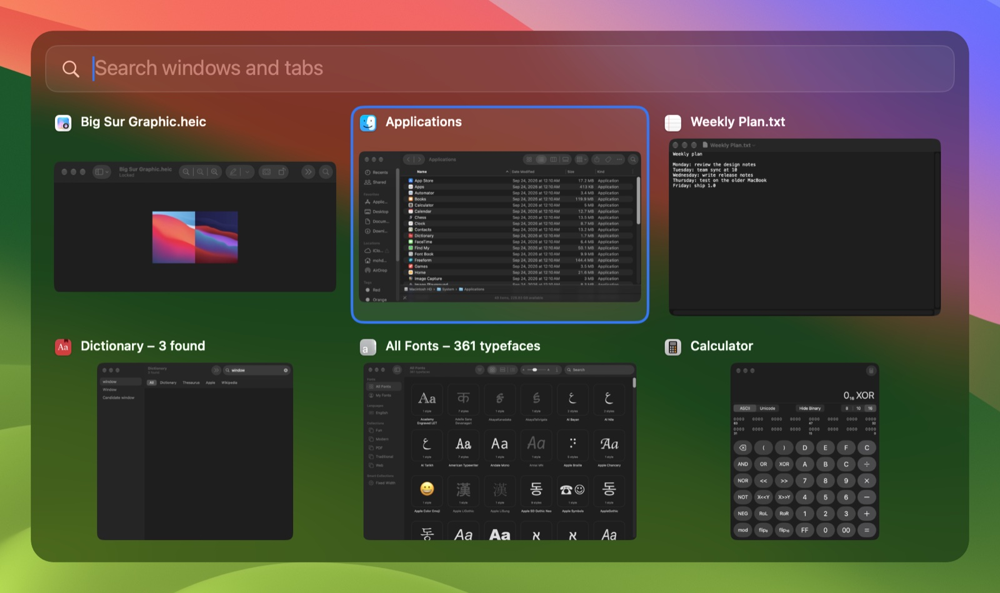
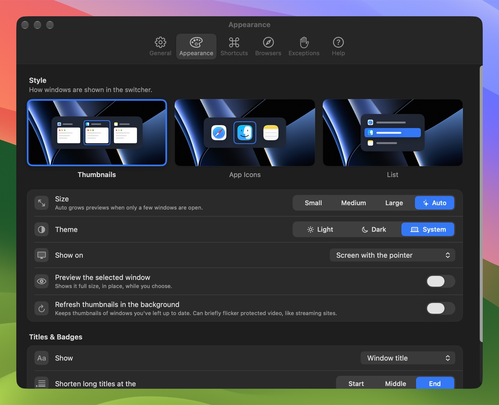
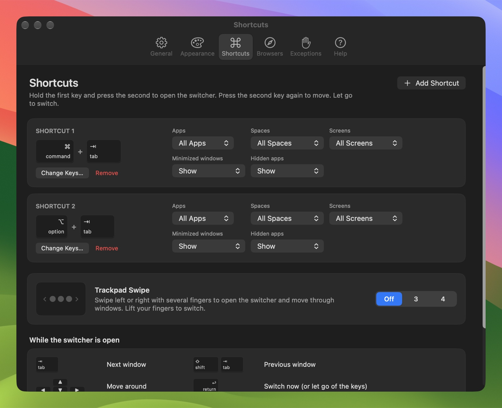

<div align="center">


# GlideTab

A window switcher for macOS. Hold Option, press Tab, and pick any window from a live preview.

[](https://github.com/mohdmahmodi/glidetab/releases/latest)
[](https://github.com/mohdmahmodi/glidetab/actions/workflows/ci.yml)
[](#requirements)
[](#requirements)
[](https://www.swift.org)
[](LICENSE)

[Website](https://glidetab.com) · [Download](https://github.com/mohdmahmodi/glidetab/releases/latest) · [Build from source](#build-from-source) · [Report a bug](https://github.com/mohdmahmodi/glidetab/issues/new/choose)

<br>

<picture>
  <source media="(prefers-color-scheme: light)" srcset="docs/images/switcher-light.jpg">
  
</picture>

</div>

## Features

- Lists each window on its own, including windows on other Spaces and displays, minimized windows, and windows of hidden apps. Badges show which is which.
- Search by typing. The search field is always there and matches window titles, app names, and open tabs in Safari, Chrome, Brave, Edge, Vivaldi, Firefox and Zen, in every Chrome profile.
- Thumbnails, app icons, or a list. In Auto size, previews grow when only a few windows are open.
- Up to nine shortcuts, each with its own filters for apps, Spaces, displays, and minimized or hidden windows. One of them can replace ⌘Tab.
- Hover over a window to close, minimize, or make it full screen.
- Optional extras: a full-size preview of the selected window, a three- or four-finger trackpad swipe, and a command line tool.
- 21 languages, VoiceOver support, and light and dark appearance.
- A 5 MB universal app with no third-party code and no background polling.

## Screenshots

<table>
  <tr>
    <td width="50%"></td>
    <td width="50%"></td>
  </tr>
  <tr>
    <td align="center">Type to search windows and tabs</td>
    <td align="center">List style</td>
  </tr>
  <tr>
    <td width="50%"></td>
    <td width="50%"></td>
  </tr>
  <tr>
    <td align="center">Appearance settings</td>
    <td align="center">Shortcuts and filters</td>
  </tr>
</table>

## Install

1. Download `GlideTab.zip` from the [latest release](https://github.com/mohdmahmodi/glidetab/releases/latest).
2. Unzip it and move GlideTab to your Applications folder.
3. Open GlideTab. Settings opens and asks for the permissions below.

| Permission | What it's used for |
| --- | --- |
| Accessibility | Required. Reads the shortcut keys and brings windows to the front. |
| Screen Recording | Thumbnails and the full-size preview. Not needed for the App Icons and List styles. |
| Automation | Asked once per browser, the first time GlideTab reads its tabs. |

GlideTab opens at login. You can turn that off in Settings → General.

### Requirements

- macOS 14 Sonoma or later
- Any Mac with Apple silicon or an Intel processor

## Using GlideTab

| Keys | Action |
| --- | --- |
| ⌥ Tab, keep holding ⌥ | Open the switcher. Each Tab moves to the next window. |
| ⇧ Tab, arrow keys | Move back, or around the grid |
| Release ⌥ | Switch to the selected window. A quick tap goes straight to your last window. |
| Type | Search windows and tabs. Return switches, Esc clears the search, then closes. |
| Hover over a window | Show its close, minimize and full screen buttons |

Everything else is in Settings, from the menu bar icon. The Help tab there covers each feature and has an FAQ.

## Build from source

You need macOS 14 or later and the Xcode Command Line Tools (Xcode 16 or later also works). There is no Xcode project; one shell script compiles everything.

```bash
xcode-select --install
```

```bash
git clone https://github.com/mohdmahmodi/glidetab.git
```

```bash
cd glidetab && ./build.sh install
```

`./build.sh install` builds a universal app, copies it to `/Applications`, adds a `glidetab` command to `/opt/homebrew/bin` or `/usr/local/bin` if one of them is writable, and opens the app.

| Command | What it does |
| --- | --- |
| `./build.sh` | Build `build/GlideTab.app` |
| `./build.sh install` | Build, install to `/Applications`, and open |
| `./build.sh test` | Build and run the unit tests (about 500,000 checks) |
| `./build.sh release` | Sign with Developer ID, notarize, staple, and zip for a release |

### Signing and permissions

macOS ties the Accessibility and Screen Recording permissions to the app's code signature.

- If you have an Apple Development certificate, `build.sh` signs with it, and permissions carry over between builds. Any Apple ID can create one for free in Xcode → Settings → Accounts → Manage Certificates.
- Without a certificate, the app is signed ad hoc and macOS asks for permission again after every build. Before granting it again, remove the old GlideTab entry in System Settings → Privacy & Security → Accessibility.
- To sign with a specific identity, set `SIGN_IDENTITY`, for example `SIGN_IDENTITY="Apple Development: Your Name" ./build.sh install`.

Copies you build yourself can't install updates from the Releases page, because the updater only accepts builds signed by the same developer. Pull the latest source and rebuild instead, and turn off automatic updates in Settings → General.

## Command line

Turn on the command line tool in Settings → General, then:

```text
glidetab list [--json]   List windows in switcher order (id, app, title, state)
glidetab focus <id>      Switch to a window
glidetab close <id>      Close a window
glidetab minimize <id>   Minimize a window
glidetab show            Open the switcher
glidetab settings        Open Settings
glidetab version         Print the version
```

The command talks to the running app, so it uses the app's permissions. While it's on, any program you run can use it too.

## Privacy

- Window titles, tab titles and addresses, and thumbnails stay in memory. They are never written to disk or sent anywhere.
- There are no analytics and no crash reporting.
- The only network request is the update check to the GitHub Releases API, at most once a day. You can turn it off in Settings → General.

## Compared with AltTab

As of October 2026.

| | GlideTab | AltTab | AltTab Pro |
| --- | :---: | :---: | :---: |
| Price | Free | Free | $9.99, or $24.99 lifetime |
| License | MIT | GPL-3.0 | GPL-3.0 source, paid builds |
| Live thumbnails, all Spaces and displays | ✓ | ✓ | ✓ |
| Minimized and hidden windows: show, hide, or list last | ✓ | ✓ | ✓ |
| Full-screen windows and windowless apps as separate options | | ✓ | ✓ |
| Search by typing | Always on | | Press S |
| Browser tabs, in every profile | ✓ | | |
| Thumbnails, app icons and list styles | ✓ | Thumbnails only | ✓ |
| Small, medium, large and Auto sizes | ✓ | Auto is Pro only | ✓ |
| Shortcuts, each with its own filters | 9 | 1 | 9 |
| Filters by app, Space and display | ✓ | More options | More options |
| Release to switch, or stay open | ✓ | ✓ | ✓ |
| Full-size preview of the selected window | ✓ | ✓ | ✓ |
| Close, minimize and full screen on hover | ✓ | ✓ | ✓ |
| Single-key actions while open (W, M, Q, H) | Typing searches | ✓ | ✓ |
| Trackpad swipe | Sideways | Sideways or vertical | ✓ |
| Sort and group options | Recently used | ✓ | ✓ |
| Animations and per-shortcut appearance | | ✓ | ✓ |
| Per-app exceptions | ✓ | More conditions | ✓ |
| Command line | Opt-in | ✓ | ✓ |
| Settings import, export and reset | ✓ | ✓ | ✓ |
| Help and FAQ | In the app | Website | Website |
| Languages | 21 | 21 | 21 |
| Automatic updates | ✓ | ✓ | ✓ |
| Crash reporting | None | Optional | Optional |
| Minimum macOS | 14 | 12 | 12 |

## Project layout

| Path | Contents |
| --- | --- |
| `Sources/KeyStateMachine.swift` | All keyboard decisions. No UI or system calls, so it can be tested exhaustively. |
| `Sources/EventTap.swift` | Event taps on dedicated input threads. |
| `Sources/Switcher.swift` | One switching session: items, search, selection, actions, preview. |
| `Sources/WindowManager.swift` | Window list (window server and Accessibility), recently used order, focusing. |
| `Sources/Browsers.swift` | Browser tabs through AppleScript (Safari, Chromium browsers) and Accessibility (Firefox). |
| `Sources/Thumbnails.swift`, `Preview.swift` | ScreenCaptureKit snapshots and the full-size preview. |
| `Sources/Panel.swift` | The switcher window. Cells are reused, so a keystroke redraws in about 1 ms. |
| `Sources/Gestures.swift` | Trackpad swipe recognition. |
| `Sources/Private.swift` | The few private macOS calls needed to focus a specific window and see other Spaces. |
| `Sources/Settings/` | The Settings window, in SwiftUI. |
| `Sources/CLI.swift`, `Updater.swift` | Command line tool and the GitHub Releases updater. |
| `Resources/` | Info.plist, entitlements, icon, and translations. |
| `Tests/` | Unit tests and fuzzing, run with `./build.sh test`. |
| `site/` | The website, a static site deployed with Cloudflare Pages. See [site/README.md](site/README.md). |

## Contributing

Bug reports and pull requests are welcome. See [CONTRIBUTING.md](CONTRIBUTING.md) for how to build, test, and add translations. To report a security issue, follow [SECURITY.md](SECURITY.md) instead of opening a public issue.

## License

GlideTab is released under the [MIT License](LICENSE).

Made by Mohd Mahmodi · [mohdmahmodi.com](https://mohdmahmodi.com) · [X](https://x.com/mohdmahmodi) · [GitHub](https://github.com/mohdmahmodi)
